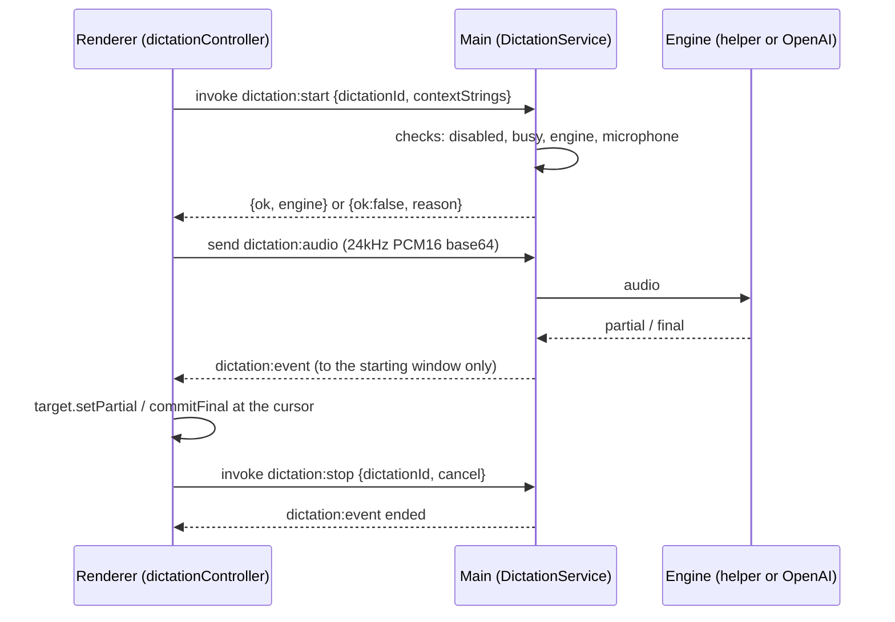

# Dictation

Dictation is speech-to-text that inserts what the user says at the cursor in the agent input, the markdown editor, or the Monaco code editor. It never speaks back and never submits. It is separate from [Voice Mode](./VOICE_MODE.md), which is a speech-to-speech agent on the OpenAI Realtime API; the two share only the microphone capture and permission code.

## Why it is built this way

- The Claude Agent SDK has no transcription API. Claude Code's own dictation uses a private endpoint authenticated with the user's claude.ai login, so it is not used.
- `webkitSpeechRecognition` does not work in Electron (Chromium's implementation needs a Google service key). The old Lexical playground `SpeechToTextPlugin` built on it was removed.
- Embedding Whisper was rejected for v1: native builds per OS and architecture, large model downloads, and CPU load, with no quality gain over Apple's on-device recognizer on Mac.
- Windows and Linux users without an OpenAI key use OS dictation (Win+H) in v1.

## Engines

| Setting | Behavior |
| --- | --- |
| Auto (default) | macOS dictation on a Mac. Elsewhere OpenAI when a key is set, otherwise start fails with `no-engine` |
| macOS dictation | Sends AppKit's `startDictation:` (the Edit > Start Dictation action) to the focused text view with `Menu.sendActionToFirstResponder`. macOS owns the mic, recognition, insertion and its UI; we get no events back |
| On-device | macOS helper only. Never falls back, so audio never leaves the machine |
| OpenAI | `gpt-4o-transcribe` in a transcription-only Realtime session with server VAD, on the key from Nimbalyst settings. Never falls back |

### macOS dictation

- Starts listening about 40 ms after the request, against about 2.8 s to first real audio on our own engine with AirPods (device wake-up).
- Works in any focused editable field, including surfaces that never registered a dictation target. The renderer (`dictationController.ts`) decides; main only sends the action (`DICTATION_IPC.systemStart`).
- Stalls before the recognizer starts (DictationIM "stage 1", never "stage 2") when our capture still holds the microphone. Our mic is closed before every request and there is no warm window. Observed on 2026-11-06 in the macOS log (`/usr/bin/log show --predicate 'process == "DictationIM"'`); the held-mic cause is the best fit, not proven.
- The shortcut fires on key release. Whether the stall also happens on key press is unconfirmed.
- No hold-to-talk: it ends after a pause or on another press (which restarts it). Its popup cannot find Chromium's caret and stays hidden.
- Recognition hints from file names are not used.

### Our engines

On-device and OpenAI remain available in Settings > Dictation and are what non-Mac platforms use.

The on-device engine is a Swift helper (`packages/electron/native/dictation-helper/main.swift`). It uses `SpeechAnalyzer` + `SpeechTranscriber` on macOS 26+ (model assets downloaded through `AssetInventory`, reported as a `preparing` event) and `SFSpeechRecognizer` with on-device recognition required on macOS 13 to 25. On macOS 27.0.1, `SpeechTranscriber` transcribed with speech-recognition authorization `not-determined` and showed no prompt; only the `SFSpeechRecognizer` path asks for that permission.

The helper speaks JSON lines over stdin/stdout (`helperProtocol.ts` parses it). It starts on the first dictation, exits after 60 seconds idle, exits when stdin closes, and is killed on app quit.

## Data flow

- `ready` and `preparing` can arrive before the start promise resolves; renderer state is keyed by `dictationId` and created before the invoke.
- A failed start sends no `ended`; the renderer cleans up on the failure path.
- Turning dictation off or closing the window ends a running dictation. Dictation refuses to start (`busy`) while a Voice Mode session is active.
- Context strings (open file names, workspace file basenames) bias recognition; main caps them at 100 strings of 64 characters, and the OpenAI prompt at 800 characters.

## Surfaces

Every surface implements `DictationTarget` (`packages/extension-sdk/src/types/editor.ts`): show a pending partial, commit a final, cancel, and report focus.

- Agent input: `renderer/dictation/textareaDictation.ts` inserts through the input's existing draft path.
- Markdown (Lexical): `lexicalDictationTarget.ts`.
- Monaco: `monacoDictationTarget.ts`, partial text as a decoration.
- Extension editors opt in with `EditorHost.registerDictationTarget(target)`; `createEditorHost` forwards to the renderer registry in `renderer/dictation/dictationTargets.ts`. Content stays owned by the editor.

## Controls and settings

- Mic button in the agent input toolbar (click to toggle).
- Hold Ctrl+Option+Space (Ctrl+Alt+Space off macOS) to talk; a short tap toggles. Esc while dictating discards the pending partial and is consumed so it does not also cancel an agent turn. Defined in `shared/KeyboardShortcuts.ts`, handled in `renderer/dictation/dictationShortcut.ts`.
- Settings > Dictation: on/off toggle, engine, language, and which engines are available. Settings live under `dictation` in the `nimbalyst-settings` store.
- When the toggle is off: no mic buttons, no shortcut handling (the key is not consumed), no shortcut hint in the keyboard shortcuts dialog, and main refuses to start, so the helper is never launched and the microphone is never requested.

## Files

| Area | Files |
| --- | --- |
| Contract | `packages/electron/src/shared/dictation.ts` |
| Main | `packages/electron/src/main/services/dictation/` |
| Helper | `packages/electron/native/dictation-helper/`, `packages/electron/scripts/build-dictation-helper.sh` |
| Renderer | `packages/electron/src/renderer/dictation/`, `store/atoms/dictation.ts`, `store/listeners/dictationListeners.ts`, `components/Settings/DictationPanel.tsx` |
| Editors | `packages/runtime/src/editors/{lexicalDictationTarget,monacoDictationTarget,dictationSpacing}.ts`, `DictationTarget` in `packages/extension-sdk/src/types/editor.ts` |

## Building the helper

- Dev: run `pnpm run build:dictation-helper` in `packages/electron` once. The binary goes to `resources/dictation-helper-bin/` (gitignored).
- Packaged: every mac build script runs it after `pnpm run build`; `mac.extraResources` copies it to `Contents/Resources/dictation-helper/nimbalyst-dictation`, and `validate-extra-resources` fails a mac build if it is missing. The script does nothing on other platforms.
- The `SpeechAnalyzer` path needs Xcode with the macOS 26+ SDK; older SDKs compile only the `SFSpeechRecognizer` path.

## Analytics

`dictation_started`, `dictation_inserted` (engine, duration, surface; never text), `dictation_enabled`, `dictation_disabled`. See [POSTHOG_EVENTS.md](./POSTHOG_EVENTS.md).
